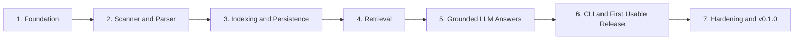

# CodeAtlas Implementation Roadmap

CodeAtlas will be built as a sequence of small, independently verifiable milestones. Each milestone must leave the repository in a working state: tests pass, public behavior is documented, and no later milestone is required to validate completed work.

> **Current status:** Milestones 1–4 are implemented: Foundation, Repository Scanner and Python Parser, Indexing and Persistence, and Retrieval. Python APIs support incremental indexing and repository-scoped search with normalized scores, metadata reranking, overlap deduplication, and exact source references. Grounded LLM answers and the CLI follow in later milestones.

## Development setup

CodeAtlas requires Python 3.11 or newer. Create a virtual environment and install the project with its development dependencies:

```bash
python -m venv .venv
python -m pip install -e ".[dev]"
```

Run the quality gates:

```bash
ruff check .
ruff format --check .
mypy src tests
pytest
```

## Configuration

Copy `codeatlas.toml.example` to `codeatlas.toml` for project-level settings. Environment variables override TOML values and use `__` for nested keys:

```bash
CODEATLAS_INDEX__TOP_K=12
CODEATLAS_OPENAI_API_KEY=your-key
```

Credentials and secret-like values are rejected in `codeatlas.toml`; provide them through environment variables. CodeAtlas does not automatically load `.env` files, preventing an unexpected local file from changing runtime behavior.

## Scan and prepare a Python repository

The scanner currently supports POSIX systems (Linux/macOS). It respects root and nested `.gitignore` rules, skips symlinks and generated directories, and bounds file reads. Preparation parses Python with the standard-library AST without importing or executing repository code.

```python
from pathlib import Path

from codeatlas.indexing.scanner import RepositoryScanner, ScanOptions
from codeatlas.parsing.service import RepositoryPreparer

scan = RepositoryScanner(ScanOptions(include=("*.py", "*.pyi"))).scan(Path("."))
prepared = RepositoryPreparer().prepare(scan)

for chunk in prepared.chunks:
    ref = chunk.reference
    print(f"{ref.file_path}:{ref.start_line}-{ref.end_line} {ref.symbol_name}")

for skipped in prepared.skipped:
    print(f"Skipped {skipped.file_path}: {skipped.reason}")
```

Scanner options are supplied through `ScanOptions`; they are not yet TOML settings. Unsupported languages and syntax errors produce per-file diagnostics. See [scanning, parsing, and chunking](docs/indexing.md) for filtering rules, source guarantees, and current limitations.

## Build a persistent local index

The default embedding provider is deterministic and offline, for testing the workflow. It does not provide meaningful semantic relevance.

```python
import asyncio
from pathlib import Path

from codeatlas.core.config import load_settings
from codeatlas.indexing.factory import create_indexing_service

service = create_indexing_service(load_settings())
manifest = asyncio.run(service.index(Path("./my-project")))
print(manifest.statistics)
```

SQLite stores the index at `<index.storage_path>/index.sqlite3` (default `.codeatlas/index.sqlite3` relative to the current working directory), without Docker. Re-running against unchanged files makes no embedding requests. Changed files replace their chunks; removed or excluded files lose their stored chunks. Provider/model, dimension, and pipeline configuration changes trigger re-embedding. Publication is atomic: a failed embedding batch preserves the previous index.

Selecting `embedding.provider = "openai"` with an explicit model and `CODEATLAS_OPENAI_API_KEY` sends chunk contents to OpenAI. This is opt-in and may incur API charges. See [provider configuration and privacy](docs/providers.md) and the [indexing lifecycle](docs/indexing.md#incremental-indexing-and-persistence) before enabling it.

## Search an index

Search embeds only the query, retrieves candidates from one repository and one index generation, then reranks and deduplicates the stored evidence. It does not invoke an LLM.

```python
import asyncio

from codeatlas.core.config import load_settings
from codeatlas.retrieval.factory import create_search_service

service = create_search_service(load_settings())
response = asyncio.run(
    service.search_text(
        repository_id="repository-id-from-the-index-manifest",
        text="Where is authentication implemented?",
    )
)

for result in response.results:
    ref = result.reference
    print(f"{result.score:.3f} {ref.file_path}:{ref.start_line}-{ref.end_line}")
    print(result.snippet)
```

`index.top_k`, `index.min_score`, and `index.candidate_multiplier` configure the default result count, final-score threshold, and candidate expansion. The query provider must exactly match the provider, model, and configured dimensions recorded by indexing. See [retrieval and ranking](docs/retrieval.md) for score semantics, consistency guarantees, and extension points.

## Delivery principles

- Keep domain models and use cases independent from provider implementations.
- Add tests with every behavior change; external AI services are never required by the default test suite.
- Prefer a thin vertical slice before adding advanced retrieval or additional providers.
- Do not execute or import code from indexed repositories.
- Keep all source code, messages, configuration, and documentation in English.
- Run `ruff`, `mypy`, and `pytest` at the end of every milestone.

## Milestone 1 — Foundation

**Goal:** establish a maintainable Python project that contributors can install and validate locally.

### Deliverables

- Create the `src/codeatlas` package and test layout.
- Configure `pyproject.toml` with Python version, runtime dependencies, and development dependencies.
- Configure Ruff, mypy, pytest, and coverage.
- Define initial domain models with Pydantic:
  - repository identity;
  - indexed file metadata;
  - parsed symbol;
  - code chunk;
  - source reference;
  - search result.
- Add domain-specific exception types.
- Add configuration loading from `codeatlas.toml` and environment variables, without storing secrets in the project file.
- Add structured logging with safe defaults.
- Add `.gitignore`, `.env.example`, license, contribution guide, and a basic CI workflow.
- Provide deterministic fake providers for later tests.

### Tests

- Package import and version tests.
- Domain-model validation tests.
- Configuration precedence and validation tests.
- Secret-redaction tests for logs and error messages.

### Exit criteria

- `pip install -e ".[dev]"` succeeds.
- `pytest`, `ruff check .`, and `mypy src` pass.
- CI runs linting, type checking, tests, and coverage.

## Milestone 2 — Repository Scanner and Python Parser

**Goal:** turn a local repository into safe, traceable structural code units without executing its code.

### Deliverables

- Implement a repository scanner that:
  - validates and resolves the repository root;
  - walks files without escaping the root through symlinks;
  - ignores binary files, common dependency/build directories, and configured patterns;
  - respects `.gitignore` where practical;
  - supports configurable include and exclude patterns;
  - records relative paths, language, size, modification time, and content hash.
- Define a language-neutral parser protocol and parser registry.
- Implement a Python parser with the standard-library AST.
- Extract modules, classes, functions, async functions, methods, imports, docstrings, parent symbols, and exact line ranges.
- Implement semantic chunking by symbol and module-level section.
- Split exceptionally large symbols while preserving their source reference and parent relationship.

### Tests

- Scanner fixtures covering ignored files, binaries, nested paths, empty repositories, and symlinks.
- Parser fixtures covering decorators, nested definitions, async functions, multiline signatures, docstrings, and syntax errors.
- Chunking tests verifying source text, symbol relationships, and line-number accuracy.
- Tests proving repository modules are never imported or executed.

### Exit criteria

- A Python repository can be scanned and converted into validated chunks.
- Every chunk maps back to an existing relative file path and valid line range.
- Unsupported and malformed files fail gracefully or are reported as skipped.

## Milestone 3 — Indexing and Persistence

**Goal:** create and maintain a local searchable index from parsed chunks.

### Deliverables

- Define `EmbeddingProvider` and `VectorStore` protocols.
- Implement one production embedding provider behind the abstraction.
- Implement deterministic fake embeddings for tests.
- Select and implement a simple persistent local vector store.
- Persist vectors together with chunk metadata and source references.
- Build an indexing service that orchestrates scan → parse → chunk → embed → store.
- Batch embedding requests and use async I/O only where it provides value.
- Implement incremental indexing with file hashes:
  - skip unchanged files;
  - replace chunks for changed files;
  - add new files;
  - remove chunks belonging to deleted files.
- Persist an index manifest containing repository identity, provider/model information, schema version, and indexing statistics.

### Tests

- Provider contract tests shared by real adapters and fakes where practical.
- Vector persistence and metadata round-trip tests.
- Indexing orchestration tests with fake providers.
- Incremental indexing tests for unchanged, changed, new, and deleted files.
- Failure tests for interrupted embedding batches and corrupted manifests.

### Exit criteria

- A repository can be indexed locally and reopened in a new process.
- Reindexing an unchanged repository performs no embedding work.
- Stored results retain accurate symbols, paths, and line ranges.

## Milestone 4 — Retrieval

**Goal:** retrieve the most relevant repository evidence without invoking an LLM.

### Deliverables

- Define retriever and reranker protocols independent of providers.
- Implement semantic vector retrieval with configurable `top_k`.
- Implement a small initial reranker, such as weighted similarity plus exact symbol/path matches.
- Normalize and deduplicate overlapping results.
- Enforce repository and index-version boundaries in every query.
- Return scores, snippets, symbols, and first-class source references.
- Add an application service for search that can be consumed by both the CLI and future interfaces.
- Document extension points for BM25, dependency graphs, and cross-encoder reranking without implementing them yet.

### Tests

- Deterministic relevance-ordering tests.
- Top-k, threshold, deduplication, and empty-result tests.
- Repository-isolation tests.
- Regression tests ensuring all returned references point to stored chunks.

### Exit criteria

- A natural-language query returns ranked, inspectable source snippets.
- Retrieval works entirely without an LLM.
- Results never cross repository boundaries or invent source locations.

## Milestone 5 — Grounded LLM Answers

**Goal:** generate useful answers that remain grounded in retrieved source code.

### Deliverables

- Define `LLMProvider`, `LLMRequest`, and `LLMResponse` abstractions.
- Implement one production LLM adapter and a deterministic fake.
- Build a context assembler with explicit token/size budgets.
- Create prompts that require the model to:
  - answer only from supplied context;
  - distinguish facts from inference;
  - state when evidence is insufficient;
  - cite only allowed source references.
- Define a structured answer model containing the answer, citations, confidence or limitations, and retrieved evidence identifiers.
- Validate model-produced citations against retrieved references and reject or remove invalid citations.
- Add timeouts and actionable provider error mapping.

### Tests

- Prompt and context-budget tests.
- Structured-response parsing tests.
- Invalid and fabricated citation tests.
- Insufficient-context behavior tests.
- Provider timeout and malformed-response tests.
- End-to-end answering tests using fake embedding and LLM providers.

### Exit criteria

- A question produces a grounded answer with validated file and line references.
- The system explicitly reports insufficient evidence instead of guessing.
- No real API credentials are required for automated tests.

## Milestone 6 — CLI and First Usable Release

**Goal:** expose the complete workflow through a clear, stable command-line interface.

### Deliverables

- Implement a Typer-based CLI with:
  - `codeatlas index <repository-path>`;
  - `codeatlas search <query>`;
  - `codeatlas ask <question>`;
  - `codeatlas status`;
  - `codeatlas clear`.
- Resolve the active repository/index explicitly and consistently.
- Add progress feedback for long-running index operations.
- Present search results and answers with readable source references.
- Map domain errors to helpful messages and stable non-zero exit codes.
- Add confirmation for destructive index removal, plus a non-interactive flag for automation.
- Complete installation, configuration, quick-start, and CLI documentation.

### Tests

- CLI help and command invocation tests.
- Success and failure exit-code tests.
- Tests for missing indexes, invalid paths, missing credentials, and provider failures.
- End-to-end test: fixture repository → index → search → ask → cited answer.

### Exit criteria

- A new user can follow the README to install CodeAtlas, index a Python project, search it, and ask a grounded question.
- CLI output includes real file paths and line ranges.
- The definition-of-done workflow works with no undocumented setup.

## Milestone 7 — Hardening and v0.1.0

**Goal:** make the first release reliable, observable, secure, and ready for an open-source portfolio.

### Deliverables

- Review filesystem handling for traversal, symlink, permission, and large-file edge cases.
- Ensure logs never expose credentials or full source/prompt content by default.
- Add retry and backoff only for safe, transient provider operations.
- Add index schema versioning and clear incompatible-index errors.
- Add bounded concurrency, cancellation cleanup, and partial-failure reporting.
- Measure indexing and retrieval on representative fixture repositories.
- Improve documentation:
  - architecture and Mermaid data-flow diagram;
  - indexing lifecycle;
  - retrieval and grounding guarantees;
  - provider implementation guide;
  - development and release instructions;
  - privacy implications of remote providers.
- Add changelog, release checklist, and Docker Compose only if the selected storage adapter requires it.

### Tests

- Security and path-handling regression tests.
- Concurrency, retry, cancellation, and partial-failure tests.
- Index migration/incompatibility tests.
- Clean-environment installation smoke test.
- Full CI matrix across supported Python versions and operating systems where practical.

### Exit criteria

- All quality gates pass from a clean checkout.
- Documentation matches actual behavior and clearly explains data sent to external providers.
- Known limitations are documented.
- The project is ready to tag as `v0.1.0`.

## Dependency sequence



The CLI milestone comes after the application services so command handlers stay thin. Minimal internal command harnesses may be used earlier for development, but the public CLI is stabilized only after indexing, retrieval, and answering contracts exist.

## Scope after v0.1.0

The following belong in later releases and should not delay the first usable version:

- Tree-sitter and additional languages;
- hybrid BM25 and vector retrieval;
- symbol and dependency graphs;
- cross-encoder or LLM reranking;
- local LLM and Ollama adapters;
- GitHub, pull request, and diff analysis;
- MCP server, web UI, and IDE integrations;
- architecture visualization, ownership analysis, and duplicate-code detection.

## Release definition of done

The initial release is complete when a developer can run:

```bash
codeatlas index ./some-python-project
codeatlas ask "How does this project authenticate users?"
```

and receive a grounded answer containing validated references to real files, symbols, and line ranges. Tests, linting, type checking, documentation, installation instructions, and secret-handling checks must all pass before release.
