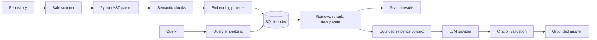

# CodeAtlas

CodeAtlas is a local-first codebase intelligence tool for Python repositories. It scans source safely, creates an incremental vector index, retrieves relevant code for natural-language queries, and produces answers whose citations are validated against stored file paths and line ranges.

The project provides a command-line interface and typed Python application services. SQLite is the only storage dependency, so no database server or Docker setup is required.

## Features

- Safe POSIX repository scanning without importing or executing target code.
- Root and nested `.gitignore` support, bounded file reads, and rejection of discovered symlinks.
- Python AST parsing with modules, classes, functions, methods, imports, docstrings, parents, and exact source ranges.
- Semantic chunking that preserves source text and symbol relationships.
- Incremental indexing based on file hashes.
- Atomic, repository-scoped SQLite snapshots with schema and generation validation.
- Bounded concurrent embedding batches with cancellation cleanup and partial-failure diagnostics.
- Semantic retrieval, metadata reranking, score thresholds, and overlap deduplication.
- Structured LLM answers with application-validated evidence IDs and source citations.
- Deterministic offline providers for development and tests.
- Optional OpenAI embedding and answer providers with explicit privacy boundaries.
- Stable CLI exit codes, structured logging, content redaction, and automation support.

## Requirements

- Python 3.11 or newer.
- Linux or macOS for safe repository scanning.
- No external service for the default offline workflow.
- An OpenAI API key only when an OpenAI provider is explicitly selected.

## Installation

Install from a local checkout:

```bash
cd CodeAtlas
python -m venv .venv
source .venv/bin/activate
python -m pip install -e "."
```

For development, install the quality and packaging tools:

```bash
python -m pip install -e ".[dev]"
```

Verify the CLI:

```bash
codeatlas --help
```

## Quick start

The default configuration is fully offline. It is useful for exercising the workflow, although fake embeddings do not provide meaningful semantic relevance and the fake LLM intentionally returns an insufficient-context answer.

```bash
codeatlas index ./my-project
codeatlas status --repository ./my-project
codeatlas search "Where is configuration loaded?" --repository ./my-project
codeatlas ask "How is configuration loaded?" --repository ./my-project
```

Search results and answer citations use repository-relative source references such as:

```text
src/codeatlas/core/config.py:134-159 (src.codeatlas.core.config.load_settings)
```

## How it works



Indexing reads each accepted file once, hashes and parses the same in-memory bytes, embeds only changed chunks, then publishes the complete snapshot in one transaction. A failed or cancelled run leaves the previous index generation intact.

Search embeds the query with the same provider profile recorded in the index, computes exact cosine similarity within one repository and generation, reranks candidates using symbol and file metadata, and removes heavily overlapping ranges.

Answering places the best evidence under explicit character and token-estimate budgets. The LLM selects opaque evidence IDs rather than writing source locations. CodeAtlas rejects unknown, duplicate, malformed, or missing citations and resolves accepted IDs to stored references itself.

See [Architecture](docs/architecture.md), [Indexing](docs/indexing.md), [Retrieval](docs/retrieval.md), and [Grounded answering](docs/answering.md) for the detailed contracts.

## CLI

### Index a repository

```bash
codeatlas index <repository-path> [--config PATH]
```

The command scans and incrementally updates the selected repository. Its output includes the resolved root, generation, file counts, embedded chunks, unchanged files, deletions, and skipped files.

### Search without an LLM

```bash
codeatlas search <query> [--repository PATH] [--top-k N] [--config PATH]
```

Search prints ranked source snippets with scores, symbols, paths, and inclusive line ranges. `--repository` defaults to the current directory.

### Ask a grounded question

```bash
codeatlas ask <question> [--repository PATH] [--top-k N] [--config PATH]
```

Ask prints the answer, confidence, validated sources, explicit inferences, and limitations. If the evidence is insufficient, the result says so instead of generating an uncited answer.

### Inspect or remove an index

```bash
codeatlas status [--repository PATH] [--config PATH]
codeatlas clear [--repository PATH] [--config PATH]
codeatlas clear --repository PATH --yes
```

`clear` removes only the selected repository snapshot. It prompts by default; `--yes` or `-y` enables automation. See the [CLI guide](docs/cli.md) for complete output and exit-code documentation.

## Configuration

CodeAtlas reads `./codeatlas.toml` when present. Pass `--config PATH` to select another file. Environment variables override TOML and use `CODEATLAS_` plus `__` between nested keys:

```bash
export CODEATLAS_INDEX__TOP_K=12
export CODEATLAS_INDEX__MAX_CONCURRENCY=2
```

Copy the complete example:

```bash
cp codeatlas.toml.example codeatlas.toml
```

The main settings and defaults are:

| Section | Setting | Default | Purpose |
| --- | --- | --- | --- |
| `embedding` | `provider` | `fake` | Embedding adapter. |
| `embedding` | `model` | `deterministic` | Embedding model identifier. |
| `embedding` | `dimensions` | unset (`8` for fake) | Requested or fake vector size. |
| `embedding` | `timeout_seconds` | `30` | Per-request timeout. |
| `embedding` | `max_attempts` | `3` | Total attempts for transient embedding failures. |
| `embedding` | `retry_base_delay_seconds` | `0.25` | Initial exponential retry delay. |
| `llm` | `provider` | `fake` | Structured-answer provider. |
| `llm` | `model` | `deterministic` | LLM model identifier. |
| `llm` | `timeout_seconds` | `60` | Provider HTTP timeout. |
| `llm` | `max_output_tokens` | `1200` | Maximum generated output. |
| `answer` | `max_context_chars` | `24000` | Serialized evidence character budget. |
| `answer` | `max_context_tokens` | `6000` | Conservative evidence token estimate. |
| `answer` | `max_evidence_chars` | `8000` | Maximum snippet prefix per result. |
| `answer` | `timeout_seconds` | `75` | Full LLM coroutine timeout. |
| `index` | `storage_path` | `.codeatlas` | Directory containing `index.sqlite3`. |
| `index` | `batch_size` | `32` | Chunks per embedding request. |
| `index` | `max_concurrency` | `4` | Maximum active embedding batches. |
| `index` | `max_chunk_lines` | `100` | Chunk split threshold. |
| `index` | `top_k` | `8` | Default final retrieval count. |
| `index` | `min_score` | `0.0` | Default final-score threshold. |
| `index` | `candidate_multiplier` | `4` | Retrieval expansion before reranking. |
| `logging` | `level` | `INFO` | Root logging level. |
| `logging` | `json` | `true` | JSON or human-readable log output. |

Relative storage paths are resolved from the process working directory. Use the same working directory and configuration for all commands, or configure an absolute storage path.

### Credentials

Secrets and secret-like keys are rejected in TOML. Supply credentials through the environment:

```bash
export CODEATLAS_OPENAI_API_KEY=your-key
```

CodeAtlas does not automatically load `.env` files. This prevents an unexpected local file from changing runtime credentials or provider selection.

## OpenAI providers

Enable meaningful remote embeddings and structured answers explicitly:

```toml
[embedding]
provider = "openai"
model = "text-embedding-3-small"
timeout_seconds = 30
max_attempts = 3
retry_base_delay_seconds = 0.25

[llm]
provider = "openai"
model = "your-structured-output-capable-model"
timeout_seconds = 60
max_output_tokens = 1200
```

OpenAI embeddings receive full new or changed chunk text. OpenAI answers receive the question, allowed evidence IDs, source metadata, and selected snippets. Remote operations may incur charges. Embeddings retry only connection failures, timeouts, HTTP 408, 409, 429, and 5xx; LLM generation is not retried automatically.

Review [Provider configuration and privacy](docs/providers.md) before enabling remote providers.

## Python API

### Index

```python
import asyncio
from pathlib import Path

from codeatlas.core.config import load_settings
from codeatlas.indexing.factory import create_indexing_service

settings = load_settings()
manifest = asyncio.run(create_indexing_service(settings).index(Path("./my-project")))
print(manifest.repository.repository_id)
print(manifest.statistics)
```

### Search

```python
import asyncio

from codeatlas.core.config import load_settings
from codeatlas.retrieval.factory import create_search_service

service = create_search_service(load_settings())
response = asyncio.run(
    service.search_text(
        repository_id="repository-id-from-the-index-manifest",
        text="Where are bearer tokens validated?",
    )
)

for result in response.results:
    ref = result.reference
    print(result.score, ref.file_path, ref.start_line, ref.end_line)
```

### Answer

```python
import asyncio

from codeatlas.answering.factory import create_answer_service
from codeatlas.core.config import load_settings

service = create_answer_service(load_settings())
answer = asyncio.run(
    service.answer_text(
        repository_id="repository-id-from-the-index-manifest",
        question="How are bearer tokens validated?",
    )
)

print(answer.answer)
for citation in answer.citations:
    print(citation.reference)
```

The lower-level scanner, parser, provider, retrieval, and storage contracts are available for custom integrations. Provider extension requirements are documented in the [provider implementation guide](docs/providers.md#provider-implementation-guide).

## Persistence and consistency

SQLite stores manifests, source chunks, references, and vectors in `.codeatlas/index.sqlite3` by default. Multiple repository snapshots can share one database because every operation is repository-scoped.

The manifest records repository identity, schema version, embedding profile, pipeline fingerprint, vector dimensions, file hashes, statistics, update time, and generation. Search requires the persisted generation and an exactly compatible embedding profile. Unsupported schemas produce an actionable error; automatic schema migration is not implemented.

Indexes contain source code in plain text. Protect them with the same filesystem permissions and retention policy as the indexed repository.

## Security guarantees

- Repository paths are resolved and constrained to a repository-relative model.
- Files are opened without following symlinks and accepted only when regular and within the size limit.
- Binary, undecodable, oversized, generated, ignored, and unsafe control-character paths are skipped.
- Python parsing uses `ast.parse`; repository modules are never imported or executed.
- Incomplete scans caused by permission or `.gitignore` failures do not replace a valid index.
- Provider and persistence failures do not publish partial generations.
- Structured logs redact credentials and content-bearing fields such as source, prompts, questions, context, snippets, and model output.
- The answer service treats indexed source as untrusted prompt data and validates citations independently of the model.

See [Security policy](SECURITY.md) and [Known limitations](docs/limitations.md) for scope and reporting instructions.

## Observability and failures

Normal structured logs include repository IDs, generation IDs, counts, batch progress, retry timing, context size, and citation state. They omit source text and remote request or response bodies.

Embedding batches run with bounded concurrency. After the first failure, queued batches do not start, active siblings are cancelled and awaited, and `PartialIndexingError` reports safe progress counts. Transient embedding retries use deterministic exponential backoff. Cancellation is never retried.

CLI failures use stable process codes:

| Code | Meaning |
| ---: | --- |
| `0` | Success, empty search, or declined removal. |
| `1` | Other expected CodeAtlas failure. |
| `2` | Invalid CLI usage or validated input. |
| `3` | Invalid or missing configuration. |
| `4` | Invalid or inaccessible repository. |
| `5` | Missing, incompatible, corrupted, or inaccessible index. |
| `6` | Embedding or LLM provider failure. |

## Performance

The included offline benchmark generates 250 Python files and 500 chunks, then measures cold indexing, unchanged reindexing, and 100 searches:

```bash
python benchmarks/benchmark_local.py
```

The committed reference run measured approximately 0.108 seconds for cold indexing, 0.060 seconds for an unchanged reindex, a 0.026-second mean search, and a 0.032-second p95 search under Python 3.14.8 on Linux/WSL2. These values are a regression reference rather than a performance guarantee. See [Performance](docs/performance.md) for the methodology and scaling constraints.

## Development

Run all quality gates before submitting a change:

```bash
ruff check .
ruff format --check .
mypy src tests benchmarks
pytest -W error
python -m build
```

The test suite uses deterministic or simulated providers and requires no network credentials. CI runs the suite on Python 3.11–3.13 under Linux and Python 3.13 under macOS, then builds and smoke-tests the wheel in a clean environment.

Contribution and release procedures are in [CONTRIBUTING.md](CONTRIBUTING.md), [CHANGELOG.md](CHANGELOG.md), and [RELEASE.md](RELEASE.md).

## Documentation

- [CLI reference](docs/cli.md)
- [Architecture and trust boundaries](docs/architecture.md)
- [Scanning, parsing, indexing, and persistence](docs/indexing.md)
- [Retrieval and ranking](docs/retrieval.md)
- [Grounded answering](docs/answering.md)
- [Providers and privacy](docs/providers.md)
- [Performance](docs/performance.md)
- [Known limitations](docs/limitations.md)
- [Security policy](SECURITY.md)

## License

CodeAtlas is available under the [MIT License](LICENSE).
