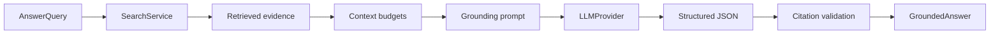

# Grounded answering

CodeAtlas turns retrieved evidence into a structured answer without trusting the model to create source locations. The model selects opaque chunk IDs; CodeAtlas verifies those IDs against the bounded context and resolves citations from stored metadata.

## Answer contract

`GroundedAnswer` contains the repository and index generation, original question, answer text, confidence, limitations, explicit inferences, admitted evidence IDs, and validated citations. Each `AnswerCitation` pairs a model-selected evidence ID with the `SourceReference` already stored for that chunk. The model never supplies a path or line number.

A supported answer must have at least one unique allowed citation and confidence `high`, `medium`, or `low`. Unknown or duplicate IDs, missing citations, malformed JSON, and inconsistent insufficient-context fields fail with `LLMProviderError`; CodeAtlas does not silently publish a partly grounded answer. An insufficient answer has no citations or inferences and uses confidence `insufficient`.

If retrieval returns no evidence, or the budget cannot admit any evidence, CodeAtlas returns an insufficient answer without invoking the LLM. A model may also explicitly report insufficient evidence. This response still records which evidence IDs were admitted, making the practical limit visible to callers.

## Context budgets

`ContextAssembler` serializes ranked evidence as compact JSON. Each item contains its chunk ID, stored path and line range, symbol, language, and snippet. Evidence is admitted in ranking order under three independent settings:

| Setting | Default | Purpose |
| --- | ---: | --- |
| `answer.max_context_chars` | 24,000 | Hard serialized-character limit |
| `answer.max_context_tokens` | 6,000 | Deterministic estimate using four UTF-8 bytes per token |
| `answer.max_evidence_chars` | 8,000 | Maximum snippet prefix for one evidence item |

Oversized snippets are truncated to the largest prefix that fits. The final answer then includes a limitation stating that evidence was truncated. Token counting is an estimate rather than a provider tokenizer result; choose conservative limits for the configured model. Question and output tokens are separate from this evidence-context budget. `llm.max_output_tokens` bounds generated output.

## Prompt and validation guarantees

The developer instruction requires the model to use only supplied evidence, keep deductions in the `inferences` field, report gaps explicitly, and cite only allowed IDs. It also identifies repository source as untrusted data and forbids following instructions embedded in snippets. Context is passed as JSON rather than interpolated into the developer instruction.

The production adapter requests strict Structured Outputs through the OpenAI Responses API, consistent with the [official OpenAI documentation](https://developers.openai.com/api/docs/guides/structured-outputs?api-mode=responses). Application validation remains mandatory: schema adherence cannot establish that a citation ID was actually supplied or that an answer is semantically supported. CodeAtlas therefore validates output with Pydantic, checks every citation against the admitted context, and constructs references internally.

These controls prevent fabricated source locations from reaching a successful `GroundedAnswer`. They do not prove that every natural-language claim follows from its cited snippet. Improving claim-level entailment requires evaluation and potentially a later verifier; current answers expose confidence, limitations, inferences, and exact evidence so users can inspect them.

## Privacy and observability

Normal logs contain repository ID, index generation, evidence count, context size, estimated tokens, citation count, and insufficient-context status. They omit the question, prompt, source, model output, and credentials. The fake provider supports offline tests. Enabling a remote LLM sends the question and admitted evidence snippets outside the machine; review [provider configuration and privacy](providers.md).
