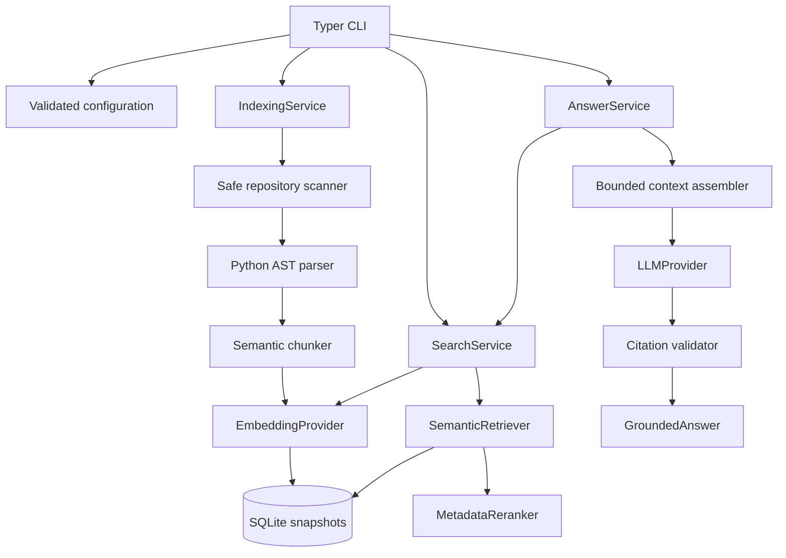

# Architecture

CodeAtlas separates domain models and application services from provider and storage adapters. The CLI is a composition layer: it resolves configuration and repository identity, constructs a service, and formats validated results. Application code depends on the `EmbeddingProvider`, `LLMProvider`, `Retriever`, `Reranker`, and `VectorStore` protocols rather than a vendor SDK.



## Data and trust boundaries

The scanner opens regular files relative to directory descriptors with no-follow flags. It decodes each file once and passes that in-memory snapshot through parsing and chunking, so hashing and parsing refer to the same bytes. Repository code is never imported or executed.

SQLite stores immutable Pydantic payloads for one published generation per repository. Indexing stages every vector before beginning the replacement transaction. Optimistic generation checks prevent concurrent writers or readers from silently crossing generations. The database stores source text and vectors without encryption.

Provider adapters are explicit egress boundaries. Fake providers keep all data local. OpenAI embeddings receive changed chunk text and the OpenAI answer adapter receives the question plus selected evidence. Application logs record identifiers, counts, durations, and outcome state; redaction removes credential and content-bearing fields.

## Indexing lifecycle

```mermaid
sequenceDiagram
    participant U as Caller
    participant I as IndexingService
    participant S as Scanner and parser
    participant E as Embedding provider
    participant D as SQLite store

    U->>I: index(repository)
    I->>S: scan and prepare changed files
    I->>D: load current generation
    par bounded embedding batches
        I->>E: embed batch
        E-->>I: vectors
    and up to max_concurrency
        I->>E: embed batch
        E-->>I: vectors
    end
    alt every batch validates
        I->>D: atomic save(expected generation)
        D-->>U: new manifest
    else failure or cancellation
        I-->>U: safe error; previous generation preserved
    end
```

See [indexing](indexing.md), [retrieval](retrieval.md), and [grounded answering](answering.md) for detailed contracts and extension points.
