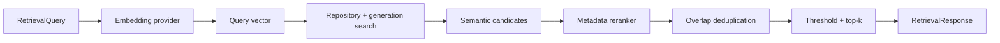

# Retrieval and ranking

CodeAtlas provides repository-scoped search without an LLM. `SearchService` embeds a natural-language query with the same embedding profile used during indexing, retrieves exact cosine candidates from SQLite, reranks them with stored metadata, removes near-duplicate ranges, and returns validated evidence.



## Application API

Use the composition root when indexing and searching share the same configuration:

```python
import asyncio

from codeatlas.core.config import load_settings
from codeatlas.retrieval.factory import create_search_service

service = create_search_service(load_settings())
response = asyncio.run(
    service.search_text(
        "repository-id-from-the-index-manifest",
        "Where are bearer tokens validated?",
        top_k=5,
        min_score=0.4,
    )
)
```

`search_text` uses `index.top_k` and `index.min_score` when overrides are omitted. `search(RetrievalQuery(...))` accepts a fully validated request for other interfaces. Blank queries, invalid thresholds, and invalid result counts fail validation before embedding.

Every `RetrievedEvidence` contains a final normalized score, original cosine similarity, chunk ID, repository ID, language, exact stored snippet, symbol type, optional parent chunk ID, and a first-class `SourceReference` with path, symbol, and inclusive line range. `RetrievalResponse.index_generation` identifies the snapshot that produced the evidence.

## Candidate retrieval and boundaries

`SemanticRetriever` requests `top_k * candidate_multiplier` candidates, capped at 1,000. The default multiplier is four and can be configured with `index.candidate_multiplier`. Expansion gives reranking and deduplication room to remove candidates; it does not guarantee that the final response contains `top_k` results.

SQLite calculates exact cosine similarity in Python and orders ties by chunk ID. A search includes an explicit repository ID and expected generation. The store loads only that repository and rejects a generation mismatch, so an index replacement during a query produces an actionable retry error. Manifest schema validation enforces the supported index version. `SearchService` also requires the provider, model, and configured dimensions to exactly match the stored embedding profile before it sends the query to a provider. Returned evidence is checked again for repository ownership.

An empty compatible index returns no results without embedding the query. A missing repository raises `IndexNotFoundError`. Provider-profile or generation mismatches raise `IncompatibleIndexError`. Invalid provider output raises `EmbeddingProviderError`.

## Ranking and deduplication

Raw cosine similarity ranges from -1 to 1. `MetadataReranker` maps it to 0–1 and uses these default normalized weights:

| Signal | Weight | Match behavior |
| --- | ---: | --- |
| Normalized cosine similarity | 0.80 | Always present |
| Symbol leaf | 0.15 | All tokens in the leaf symbol occur in the query |
| File name/stem | 0.05 | All file-name tokens occur in the query |

Token matching is case-insensitive, splits punctuation and camel case, and uses only persisted metadata. Scores are clamped to 0–1 and ties use semantic similarity followed by chunk ID, making ordering deterministic. `min_score` applies to this final score.

Chunks can overlap because classes include method bodies and functions include nested definitions. After reranking, CodeAtlas retains the higher-ranked candidate when two ranges are in the same file and their intersection covers at least 80% of the shorter range. Distinct files and partially overlapping neighboring ranges remain separate. This favors concise high-ranking evidence but may omit a useful enclosing symbol; callers can lower candidate filtering or use the lower-level retriever when they need raw structural overlap.

## Extension points

`Retriever` and `Reranker` are protocols independent of embedding vendors and SQLite. A future hybrid retriever can combine vector similarity with BM25, symbol relationships, or file/dependency graphs while preserving repository and generation constraints. A cross-encoder can implement `Reranker` and return the same evidence contract. Those features are intentionally deferred; the current implementation performs no lexical corpus search and uses no LLM.

The default fake embedding provider is deterministic but not semantically meaningful. It supports offline tests and workflow validation. Meaningful natural-language ranking requires an embedding model suited to the indexed code. With a remote provider, the query text is sent externally just as changed chunks are during indexing; review [provider privacy guidance](providers.md) before enabling it.
